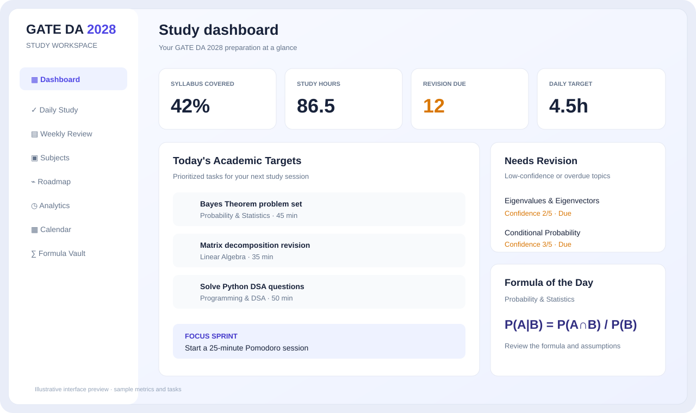
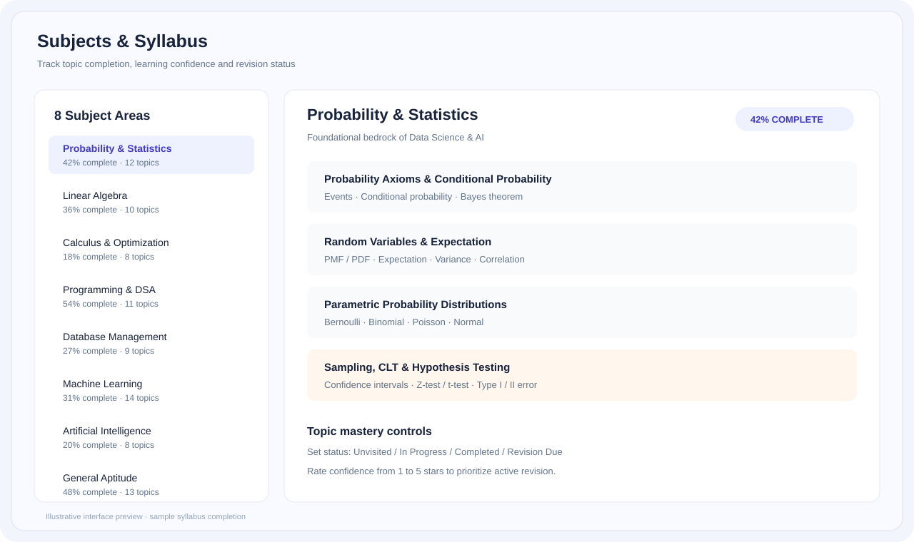
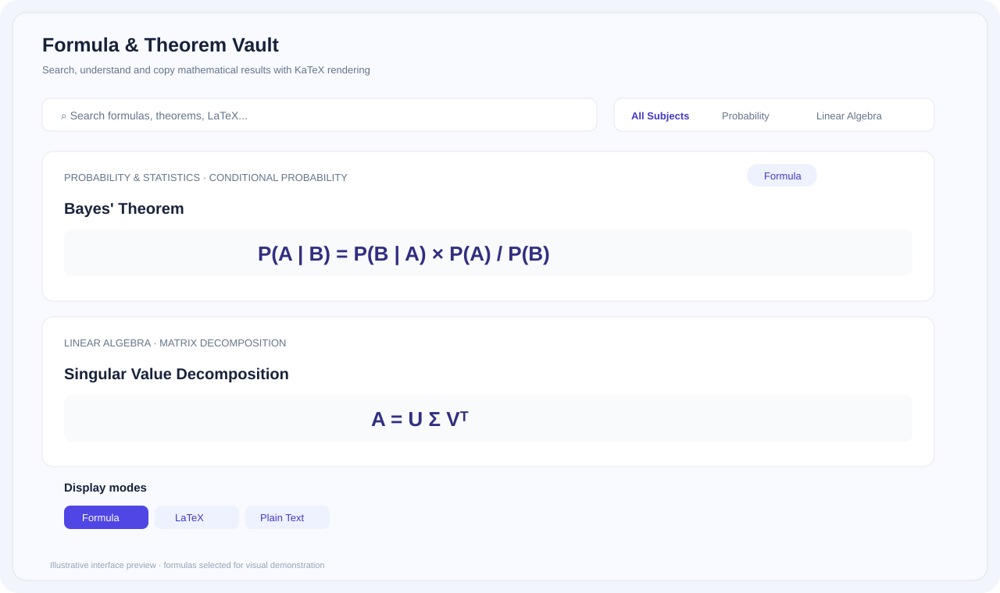
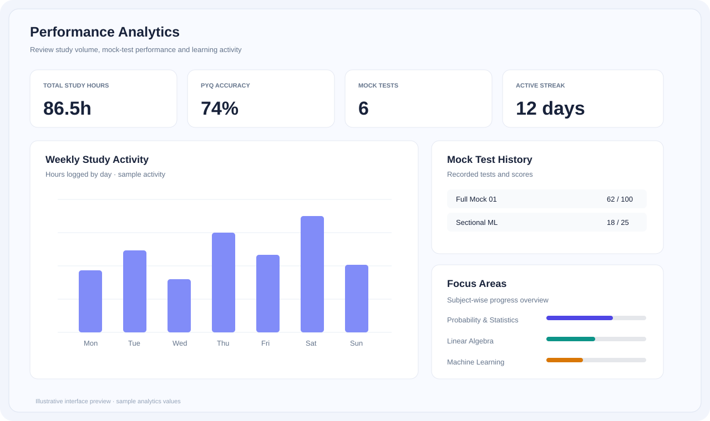

<div align="center">

# GATE DA 2028 — Study Portal

### A focused academic workspace for GATE Data Science & Artificial Intelligence preparation

Plan your study, track syllabus mastery, revise using active recall, practise mathematical results and review mock-test performance — in one place.

<p>
  <a href="https://gate-2028.vercel.app/"></a>
  <a href="https://github.com/abhimeh-1824/GATE-2028"></a>
</p>

<p>
  
  
  
  
  
  
</p>

</div>

---

## Overview

GATE DA 2028 is a study-planning and performance-tracking web application built for candidates preparing for the **GATE Data Science and Artificial Intelligence (DA)** paper.

It combines a structured subject-wise syllabus with daily task planning, topic-confidence tracking, revision reminders, formula reference material, mock-test logging and progress analytics. The aim is to make preparation more measurable: students can plan work, record what they complete, identify weak areas and decide what to revise next.

The application includes a public landing page, a gated study workspace, Supabase authentication, local demo access and optional cloud synchronisation for supported study data.

> **Important:** This is an independent preparation tool, not an official GATE portal or a substitute for the official syllabus, information brochure, exam notifications or question papers. Subject weightages and target-rank figures shown in the app are planning estimates/aspirational targets, not official guarantees.

## Live Application

**[Open GATE DA 2028 Study Portal](https://gate-2028.vercel.app/)**

The landing page provides an overview and an instant demo-preview route. Full cloud features require a configured account. Register or sign in through the application; a demo mode is also available for exploring the workspace.

---

## Screenshots & Interface Previews

The repository currently does not contain captured application screenshots. The images below are **illustrative SVG mockups** created for this README to show the product areas; sample numbers and progress are not live user data.

### Study dashboard



### Subject syllabus and revision workspace



### Formula vault and mathematical reference



### Analytics and calendar



---

## Core Features

### 1. Study dashboard

- Overview of study goals, time logged, syllabus completion and revision workload.
- Daily academic targets and task shortcuts.
- Weekly pace and study-hour summaries.
- Formula-of-the-day and high-priority revision prompts.
- Countdown to the configured target exam date.

### 2. Subject-wise syllabus tracker

The curriculum workspace is organised around eight preparation areas:

| Subject area | What is tracked |
|---|---|
| Probability & Statistics | Probability, distributions, expectation, inference and related topics |
| Linear Algebra | Vector spaces, matrices, eigenvalues, projections and SVD |
| Calculus & Optimization | Differentiation, multivariable calculus, gradients and optimization |
| Programming, DSA & Python | Python concepts, complexity, data structures, algorithms and graphs |
| Database Management & Warehousing | Relational concepts, SQL, normalization, indexing and warehousing |
| Machine Learning | Core ML methods, model objectives, evaluation and mathematical foundations |
| Artificial Intelligence | Search, reasoning and AI fundamentals |
| General Aptitude | Quantitative, verbal and reasoning practice |

Each subject contains topics and subtopics. Learners can update topic status, rate confidence, track PYQ practice and attach their own video, PDF or reference links.

### 3. Active-recall and spaced-revision workflow

- Mark topics as unvisited, in progress, completed or due for revision.
- Rate topic confidence on a star scale.
- Surface low-confidence or overdue topics in the revision queue.
- Use the weekly view to inspect topics requiring attention and topics with strong confidence.
- Plan revision sprints and milestones in the calendar.

The revision queue is a study aid. Its schedule and priority are based on recorded topic status/confidence, not a guarantee of retention or exam performance.

### 4. Formula & Theorem Vault

- Mathematical expressions are rendered with KaTeX.
- Search formulas by title, topic, subject or text.
- Switch between rendered formula, LaTeX source and plain-text representation.
- Copy LaTeX for notes and external documents.
- Review explanations and common conceptual/exam traps where available.

### 5. Daily planning and Pomodoro focus timer

- Create tasks with subject/topic, priority and estimated time.
- Mark tasks complete and review pending work.
- Run focus, short-break and long-break timer modes.
- Completed focus sessions can be recorded as study time.
- Maintain study notes and review the weekly schedule.

### 6. Mock tests, PYQs and performance analytics

- Record full-length, subject-level and sectional tests.
- Track scores, accuracy, percentile, time and diagnostic notes where entered.
- Monitor topic/PYQ progress and study activity over time.
- Review strengths and weak areas using the analytics workspace.
- Use the calendar to schedule mock tests and revision events.

This is a tracker and analysis workspace; it does not claim to conduct an official GATE CBT or produce a verified AIR prediction.

### 7. Roadmap, guide and exam calendar

- Multi-phase preparation roadmap from mathematical foundations to mock-test practice.
- Subject-wise strategy notes, suggested resources and common traps.
- Calendar for study blocks, milestones, revision sprints and mock tests.
- Platform tour for exploring key workflows.

### 8. Peer progress comparison

The peer comparison screen is designed to display progress metrics from supported Supabase records while masking peer email addresses in the UI. Availability and accuracy depend on database configuration, data-sharing policy and the records present.

### 9. Account, cloud sync and data backup

- Supabase-based sign-in, registration and password-reset flow.
- Guest/demo access for product exploration.
- Per-user study state and supported cloud synchronisation.
- Export study data to JSON and restore from a backup file.
- Optional linked-applet synchronisation controls.

---

## Application Architecture

The application is a React single-page application built with Vite. The main app coordinates route-like workspace views, shared study state, authentication and modal workflows.

```text
GATE-2028/
├── src/
│   ├── components/
│   │   ├── common/          # Shared UI and error boundary
│   │   ├── modals/          # Auth, formula vault, backup, tasks, search, settings
│   │   ├── peer/            # Peer comparison charts and detail views
│   │   ├── views/           # Dashboard, daily, weekly, subjects, roadmap, analytics
│   │   ├── widgets/         # Revision and study widgets
│   │   ├── Sidebar.tsx
│   │   └── TopBar.tsx
│   ├── context/
│   │   └── StudyContext.tsx # Shared study state and application actions
│   ├── data/
│   │   ├── gateDaSyllabus.ts
│   │   └── subjectResources.ts
│   ├── lib/
│   │   ├── supabase.ts
│   │   ├── supabaseService.ts
│   │   └── peerProgressService.ts
│   ├── types/
│   ├── utils/
│   ├── App.tsx
│   └── main.tsx
├── docs/
│   └── screenshots/         # README interface previews
├── server.ts                # Express sync/static server
├── vite.config.ts
├── index.html
├── .env.example
└── package.json
```

### State and data flow

- **StudyContext** exposes shared state for subjects, tasks, mock tests, milestones, calendar events, settings and timer controls.
- **Local persistence** keeps user-specific study state available in the browser.
- **Supabase** provides authentication and supported cloud data operations.
- **Peer progress service** reads supported cohort metrics and prepares display-safe peer profiles.
- **Express server** provides health and linked-applet sync endpoints and serves the built frontend in the configured server deployment.

---

## Technology Stack

| Layer | Technologies |
|---|---|
| Frontend | React 19, TypeScript |
| Build tooling | Vite 8 |
| Styling | Tailwind CSS 4 |
| Icons & motion | Lucide React, Motion |
| Mathematical rendering | KaTeX |
| Authentication & cloud data | Supabase Auth, Supabase JS |
| Server | Node.js, Express |
| AI integration | Google GenAI SDK (optional functionality) |
| Deployment | Vercel for the linked live frontend; Express server support in repository |

---

## Getting Started

### Prerequisites

- Node.js **22 or later** (as declared in `package.json`).
- npm.
- A Supabase project for account authentication and cloud data features.
- Gemini API key only if the optional Gemini-powered functionality is used.

### 1. Clone the repository

```bash
git clone https://github.com/abhimeh-1824/GATE-2028.git
cd GATE-2028
```

### 2. Install dependencies

```bash
npm install
```

### 3. Configure environment variables

Create a local environment file:

```bash
cp .env.example .env.local
```

Configure the values for your own services:

| Variable | Purpose |
|---|---|
| `VITE_SUPABASE_URL` | Supabase project URL |
| `VITE_SUPABASE_ANON_KEY` | Supabase public/anon key |
| `VITE_APP_URL` | Public app URL used by password-reset redirects |
| `GEMINI_API_KEY` | Optional Gemini integration |
| `APP_URL` | Server/deployment app URL where required |

Do not commit real secrets or private service-role keys. Keep production credentials in Vercel/hosting environment settings.

### 4. Start the development server

```bash
npm run dev
```

Open [http://localhost:3000](http://localhost:3000).

### 5. Run validation and production build

```bash
npm run lint
npm run build
npm run preview
```

- `npm run lint` runs the TypeScript check.
- `npm run build` builds the Vite frontend and bundles the Express server entry.
- `npm run preview` serves the production frontend bundle locally.

---

## Server & Deployment Notes

The repository includes an Express server entry (`server.ts`) for health checks, linked-applet sync endpoints and static serving of the `dist` directory.

The Vercel live application is linked above. The repository also contains server-oriented configuration for deployments that run the Express process. These deployment modes have different runtime requirements; verify the configured platform and environment variables before changing the production start command.

Useful endpoints exposed by the Express server include:

| Endpoint | Purpose |
|---|---|
| `GET /api/health` | Health status and process uptime |
| `GET /health` / `GET /healthz` | Alternate health checks |
| `GET /api/sync/linked` | Read supported linked-applet sync state |
| `POST /api/sync/linked` | Write supported linked-applet sync state |

The sync server has an allow-list of applet IDs, payload shape checks, a request-size limit and in-memory IP rate limiting. Review the current server security model before exposing sync endpoints to untrusted clients.

---

## Security, Privacy & Known Limitations

This project handles account credentials, personal study progress and peer benchmarking data. Before using real student accounts:

- Verify Supabase Row Level Security (RLS) for every table and operation.
- Ensure cloud reads and writes are bound to the authenticated user's identity.
- Treat localStorage identity only as a client-side convenience, never as server authorization.
- Keep private API keys and service-role credentials out of browser bundles and source control.
- Review the linked-applet sync endpoints for authenticated ownership enforcement.
- Make peer profile visibility opt-in and restrict database reads to approved fields.
- Validate imported backup records and file sizes before applying them.
- Confirm exam dates, marking rules, syllabus wording and references against the official GATE information brochure and syllabus.

The repository includes an audit report documenting remaining security and data-integrity issues. It should be reviewed before describing the platform as production-secure or using it with sensitive real-user data.

---

## Project Status

The repository contains the core study workspace, syllabus dataset, authentication flows, analytics views, formula vault, backup workflow, Supabase integration and Express sync server. Build/type-check results and the remaining audit findings are documented in `AUDIT_REPORT.md`.

This is an evolving personal/portfolio project. Features that depend on Supabase schema, environment configuration or external service credentials may require deployment-specific setup.

## Author

**Abhishek Mehra**

- GitHub: [@abhimeh-1824](https://github.com/abhimeh-1824)
- Live project: [GATE DA 2028 Study Portal](https://gate-2028.vercel.app/)

---

<div align="center">

**Study with intent. Revise with evidence. Improve with consistency.**

</div>
